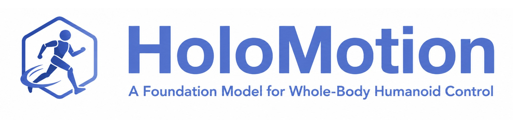
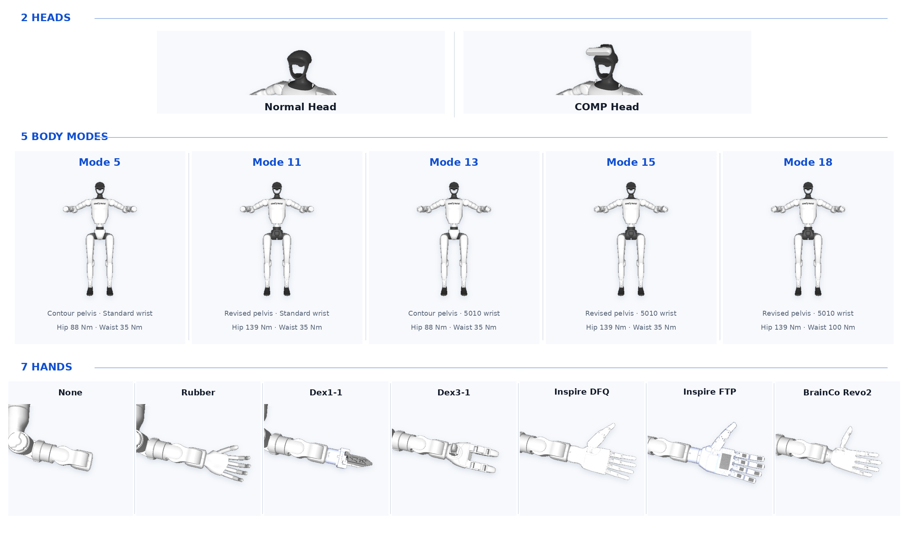

<div align="center">



[](https://horizonrobotics.github.io/robot_lab/holomotion/)
[](https://huggingface.co/collections/HorizonRobotics/holomotion)
[](https://deepwiki.com/HorizonRobotics/HoloMotion)
[](https://horizonrobotics.feishu.cn/docx/Xs3cdEI8bo1EZuxUfzjckTgKn2c)
[](https://arxiv.org/abs/2605.15336)
[](https://space.bilibili.com/650643249)


</div>

# News
- [2026.07.16] HoloMotion v1.4 introduces HoloRetarget at 3,000+ FPS on RTX 4090 for training data generation and 300+ FPS entirely on-robot for teleoperation, plus HoloSMPL for 10+ datasets and devices.
- [2026.05.15] HoloMotion v1.3 scales from 60M to 0.4B parameters and 80 to 2000+ hours of motion data, while improving policy inference from ~100 to ~300 FPS.
- [2026.04.04] HoloMotion v1.2 provides pre-trained motion tracking and velocity tracking models for the community to deploy directly.


# Why HoloMotion?

## Larger, Faster and Stronger

HoloMotion scales humanoid whole-body control through a reference-conditioned MoE Transformer, large-scale motion data, and an optimized training-to-deployment pipeline, delivering stronger motion tracking with real-time inference efficiency.

<p align="center">
  
</p>


## Scales Toward 4-Any Humanoid Control

The roadmap of HoloMotion advances through four generalization targets, from motion imitation to command following, terrain adaptation, and embodiment transfer.

<p align="center">
  
</p>

| Version  | Target Capability | Status      | Description                                                                                                                         |
| -------- | ----------------- | ----------- | ----------------------------------------------------------------------------------------------------------------------------------- |
| **v1** | Any Pose          | ✅ Done        | Achieve robust tracking and imitation of diverse, whole-body human motions, forming the core of the imitation learning capability.  |
| **v2** | Any Command       | 🚀 Next        | Enable language- and task-conditioned motion generation, allowing for goal-directed and interactive behaviors.                      |
| **v3** | Any Embodiment    | 🧭 Planned    | Generalize control policies across humanoids with varying morphologies and kinematics, achieving true embodiment-level abstraction. |
| **v4** | Any Terrain       | 🧭 Planned    | Master adaptation to uneven, dynamic, and complex terrains, enhancing real-world operational robustness.                            |


## Unifies Diverse Motion Sources

HoloSMPL standardizes VR, inertial, optical, and vision capture into a shared representation for HoloRetarget.

<p align="center">
  
</p>

## One Policy Across Modular G1 Configurations

HoloMotion runs one shared motion policy across 2 heads, 5 G1 29-DoF body modes, and 7 hands, covering 66 unique compatible configurations without training a separate policy for every hardware assembly.

The five body modes retain the same 29-DoF kinematic layout while varying pelvis and wrist geometry together with hip, wrist, and waist actuator specifications. The supported modules span Normal and COMP heads; Mode 5, 11, 13, 15, and 18 bodies; and None, Rubber, Dex1-1, Dex3-1, Inspire DFQ, Inspire FTP, and BrainCo Revo2 hand options.

<p align="center">
  
</p>

## Closes the Loop From Data to Robots

HoloMotion provides a clear, modular framework for bridging motion data, policy learning, simulation evaluation, and real-robot deployment.

<p align="center">
  
</p>

## No Per-User Training Required

Whether you want to replay motions, stream live teleoperation, or train a custom policy, HoloMotion provides a direct path into the workflow:

| User Goal | Start Here | What You Need |
| --------- | ---------- | ------------- |
| **Offline motion tracking**<br/>Replay local motion clips for demos such as dance or scripted performances. | [Real-world deployment: Offline Motion](docs/realworld_deployment.md#offline-motion-tracking) | The v1.4.1 Docker image and retargeted `.npz` motion clips. No model training is required. |
| **Online motion tracking**<br/>Follow live VR or teleoperation motion streams. | [Real-world deployment: Teleoperation](docs/realworld_deployment.md#live-teleoperation) | The v1.4.1 Docker image, robot deployment setup, and a live motion source. No model training is required. |
| **Train your own model**<br/>Build a custom policy from your own motion data. | [Environment setup](docs/environment_setup.md) → [HoloSMPL conversion](holosmpl/README.md) → [Retargeting](docs/motion_retargeting.md) → [Training](docs/train_motion_tracking.md) → [Evaluation](docs/evaluate_motion_tracking.md) | Training environment, curated motion data, retargeted HDF5 datasets, and GPU resources. |

# Join Us

We are hiring full-time engineers, new graduates, and interns who are excited about humanoid robots, motion control, and embodied intelligence.
Send your resume by scanning the **WeChat** QR code below to get in touch with us.

<p align="center">
  
</p>

# Projects Using HoloMotion

We are glad to see HoloMotion being used as a motion control foundation for humanoid research and applications.

| Project | Description | Links |
| --- | --- | --- |
| OMG: Omni-Modal Motion Generation for Generalist Humanoid Control | Uses HoloMotion as the motion control foundation for omni-modal motion generation and generalist humanoid control. | [Paper](https://arxiv.org/abs/2606.10340) / [Project](https://tsinghua-mars-lab.github.io/OMG/) / [Code](https://github.com/Tsinghua-MARS-Lab/OMG) |
| HoloAgent-0: A Unified Embodied Agent Framework with 3D Spatial Memory | Uses HoloMotion as the humanoid whole-body motion skill within its closed-loop Embodied AgentOS. | [Paper](https://arxiv.org/abs/2606.23565) / [Project](https://horizonrobotics.github.io/robot_lab/holoagent/) / [Code](https://github.com/HorizonRobotics/HoloAgent) |


# Citation

```
@misc{chen2026holomotion1,
  title = {HoloMotion-1 Technical Report},
  author = {Maiyue Chen and Kaihui Wang and Bo Zhang and Xihan Ma and Zhiyuan Yang and Yi Ren and Qijun Huang and Zihao Zhu and Yucheng Wang and Zhizhong Su},
  year = {2026},
  eprint = {2605.15336},
  archivePrefix = {arXiv},
  primaryClass = {cs.RO},
  url = {https://arxiv.org/abs/2605.15336}
}
```

# Acknowledgements

This project is built upon and inspired by several outstanding open source projects:

- [ASAP](https://github.com/LeCAR-Lab/ASAP)
- [BeyondMimic](https://github.com/HybridRobotics/whole_body_tracking)
- [GMR](https://github.com/YanjieZe/GMR)
- [GVHMR](https://github.com/zju3dv/GVHMR)
- [Humanoidverse](https://github.com/LeCAR-Lab/HumanoidVerse)
- [Mink](https://github.com/kevinzakka/mink)
- [MotionMillion](https://github.com/VankouF/MotionMillion-Codes)
- [PBHC](https://github.com/TeleHuman/PBHC)
- [PHC](https://github.com/ZhengyiLuo/PHC?tab=readme-ov-file)
- [ProtoMotion](https://github.com/NVlabs/ProtoMotions/tree/main/protomotions)
- [SONIC](https://github.com/NVlabs/GR00T-WholeBodyControl)


## router-k1：K1 增量 MoE 源码快照

这是基于 HoloMotion 当前工作区导出的源码快照，保留上游许可证与署名。
主要入口为
`holomotion/config/training/motion_tracking/motion_tracking_booster_k1_moonwalk_admission.yaml`。
它继承任务奖励隔离配置，使用冻结旧 Critic、独立滑步 Critic、内部新增专家与
准入 gate，以及相同批次布局的缓存重算。历史单 Critic 版本仍保留作显式复现实验。

本轮完成的是代码审查、CPU 单元回归及限定条件下的 CPU 检查；此仓库不是已训练完成
的滑步模型。新增隔离版本的技能学习、自动 gate 校准与误选率、GPU 数值一致性、
旧动作闭环保持以及站立→滑步→站立的稳定切换，均不能由源码或训练 reward 代替验证。
文档中的历史训练和固定旧路径结果不构成新版自动路由已经通过的证据。
训练与自动推进继续暂停；上传源码不启动训练、仿真或真实机器人。

### 外部文件与环境

此快照不包含数据集、训练权重、运行日志、`test_outputs`、参考仓库或机器本地环境文件。
`train.env`/`deploy.env` 不上传；需要根据本机环境配置。可复制 `train.env.example`
为本地 `train.env`，设置训练环境路径，并按 `docs/environment_setup.md` 安装依赖。
Isaac Lab、Isaac Sim 与对应版本依赖需要在目标机器另行准备。

完整实际权重/数据审查依赖外部原始 `model_11999.pt`、对应 Actor/Critic sidecar 与
保存的 `config.yaml`。配置当前登记的原始位置是：

`logs/HoloMotionK1SequentialCurriculum/overnight_20261020_153041_Bl3s1P/stage_3_complex/model_11999.pt`

另需按配置恢复 `data/holomotion_k1_v1/filtered_robot/moonwalk_v14` 的滑步参考数据，以及
`test_outputs/current3998_regression_20261021/reference_subset` 中登记的旧动作参考集合。
checkpoint、数据、奖励、观测和路由配置有严格哈希/TaskSpec 校验；不能随意替换文件、
改动登记字段或跳过检查来伪装完成恢复。没有这些外部输入时，实际检查点审计、完整
launcher/evaluation 测试和仿真实验不可复现；仍可运行不依赖数据的组件 CPU 单元测试。

例如，在已安装项目依赖的环境中执行（不会启动训练）：

```bash
source train.env
PYTHONPATH="$PWD" OMP_NUM_THREADS=2 "$Train_CONDA_PREFIX/bin/python" -m pytest -q \
  tests/test_expert_admission.py tests/test_cached_replay.py \
  tests/test_internal_moe_gate_loss.py
```

两套 K1 URDF/XML/STL 资产分别保存在 `assets/robots/booster_k1` 和 retarget vendor
目录；生成的 USD 未纳入快照。`SOURCE_EXPORT_MANIFEST.json` 记录导出时文件哈希与排除
策略，不含 Git 历史、远程认证信息或运行产物。文档中指向本机 `test_outputs` 的历史
证据链接需要原工作区，不能把它们当作本仓库附带的实验结果。
